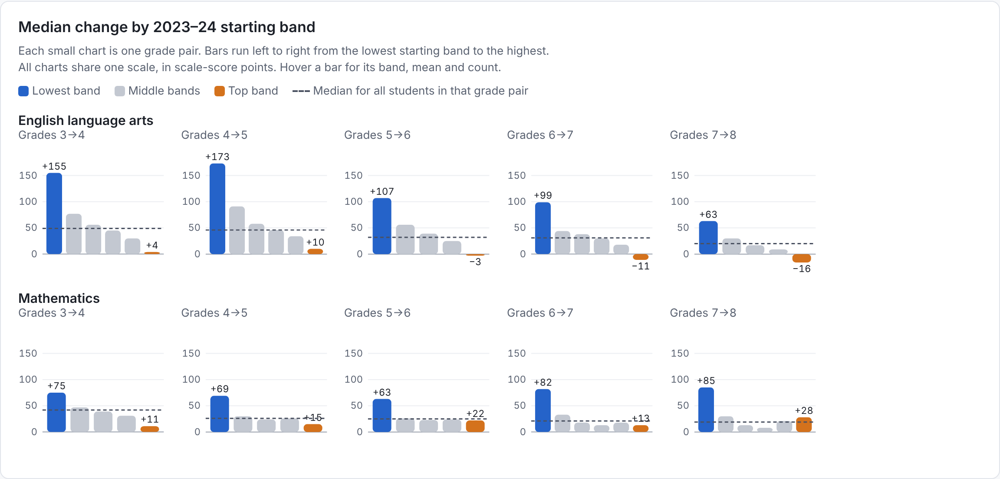
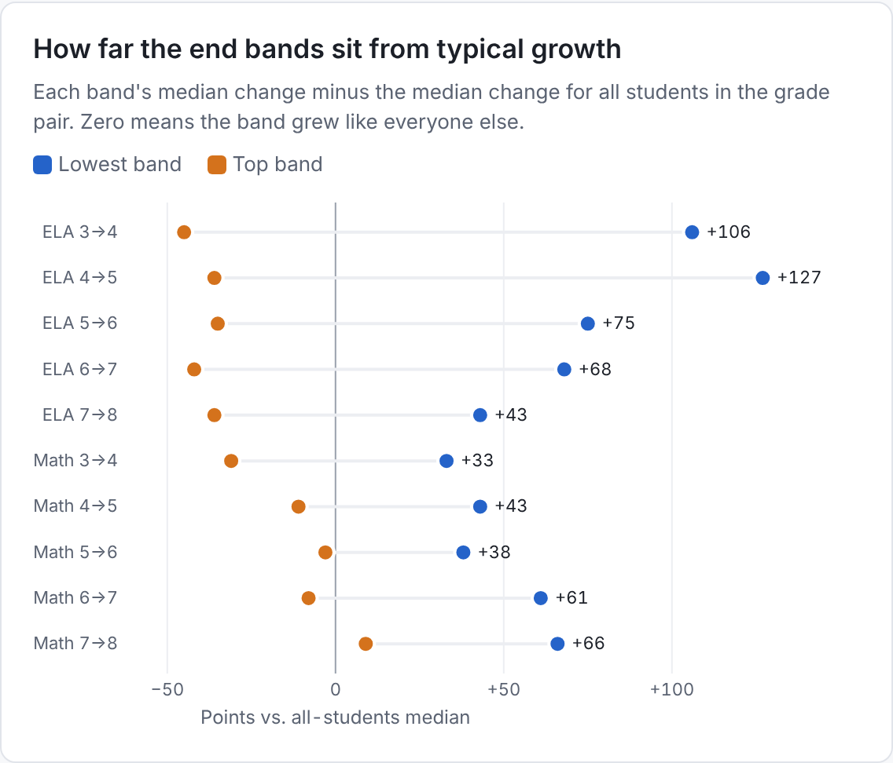
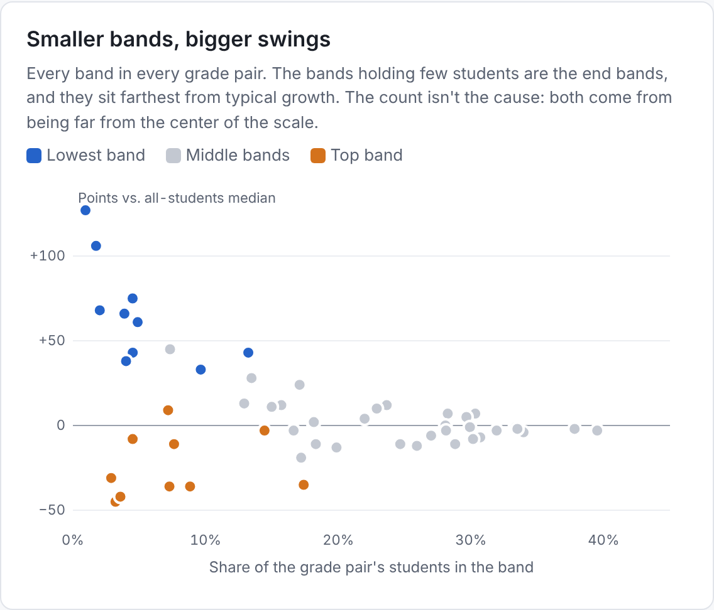

# CAASPP growth by starting band, 2024–25

Statewide matched students, grades 3–8. Students are grouped by their 2023–24 scale score band, and each chart shows how much their score changed in 2024–25.

Interactive version: [index.html](index.html) (open it through GitHub Pages to get hover details and the filterable benchmark table).

## Median change by starting band

The lowest band gains the most in every grade pair. The top band gains the least in 9 of 10, and loses ground in most ELA grades.

## How far the end bands sit from typical growth

## Smaller bands, bigger swings

Source: California Department of Education, CAASPP 2024–25 Change in Scale Score by 2023–24 Scale Score Range (October 2025).
